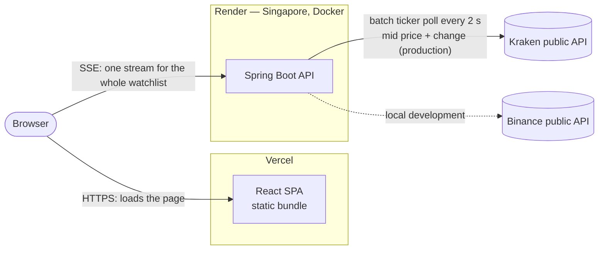

# Architecture

## Deployed topology



The browser loads static files from Vercel, then opens **one** Server-Sent Events connection
directly to the API. The API polls the upstream exchange and fans each tick out to every
connected client.

## Inside the API

```mermaid
flowchart TB
    ctrl[PriceController<br/>GET /prices/symbol · /prices/stream · /prices/source]
    stream[PriceStreamService<br/>subscriber registry, fan-out]
    poller[PricePoller<br/>@Scheduled]
    port{{PriceSource port}}
    bin[BinancePriceSource]
    kr[KrakenPriceSource]
    cfg[PriceSourceConfig<br/>price-source.provider]

    ctrl --> stream
    ctrl --> port
    poller --> port
    poller --> stream
    port --- bin
    port --- kr
    cfg -. selects exactly one .-> port
```

- **Port and adapters.** Everything depends on the `PriceSource` interface. Which adapter backs
  it is configuration (ADR 0005).
- **Pull → push.** Upstream REST APIs cannot push, so `PricePoller` pulls one batch per tick and
  `PriceStreamService` pushes to subscribers (ADR 0001, ADR 0003).
- **One stream per client**, not per symbol, because browsers cap concurrent HTTP/1.1
  connections per origin at about six (ADR 0003).
- **Errors are typed:** unknown symbol → 404, upstream trouble → 503, as RFC 9457 problem details.

## Decision records

| ADR | Decision |
|---|---|
| [0001](adr/0001-sse-over-websocket-for-live-price-push.md) | SSE over WebSocket for live push |
| [0002](adr/0002-explicit-client-http-request-factory.md) | Explicit HTTP client with timeouts |
| [0003](adr/0003-one-sse-stream-per-client-not-per-symbol.md) | One stream per client, not per symbol |
| [0004](adr/0004-host-on-render-and-vercel.md) | Render + Vercel hosting |
| [0005](adr/0005-select-the-price-source-by-configuration.md) | Config-selected price source; Kraken in production |
| [0006](adr/0006-mid-price-and-honest-change-window.md) | Mid price, and a labelled change window per source |
